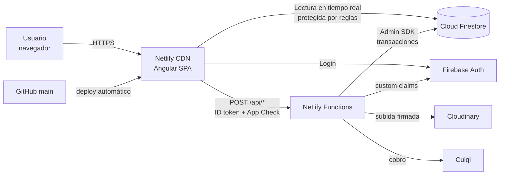
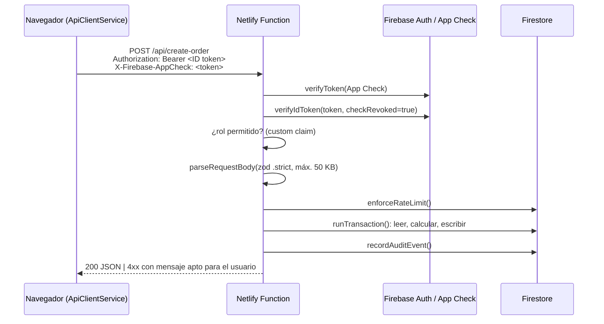

# Arquitectura y stack tecnológico

Este documento explica **cómo están construidos** los dos sistemas web desarrollados con el mismo método:

| Proyecto | Qué resuelve | Roles |
|---|---|---|
| **Farmasalud** | E-commerce y gestión de una cadena de 10 boticas (Trujillo): catálogo, venta online, stock por sucursal, proveedores/compras y delivery. | Administrador · Trabajador · Cliente |
| **AsisPRO** | Control de asistencia, permanencia y participación de clases virtuales en Blackboard Collaborate, con planes de suscripción por institución. | Coordinador · Docente · Estudiante |

Ambos comparten **la misma arquitectura y el mismo stack** (tomados del POS de referencia *Alliker* y mejorados en seguridad). Lo que cambia es el dominio de negocio.

---

## 1. Stack tecnológico

### Frontend

| Tecnología | Versión | Para qué se usa |
|---|---|---|
| **Angular** (componentes *standalone*) | 21 | SPA con rutas por rol, carga diferida (*lazy loading*) y *signals* para el estado. |
| **TypeScript** | 5.9 | Tipado estricto en frontend y backend (modelos compartidos). |
| **RxJS** | 7.8 | Flujos reactivos (sesión, consultas en vivo de Firestore). |
| **Firebase JS SDK** | 13 | Auth (correo/contraseña y Google), Firestore en tiempo real, App Check. |
| **Bootstrap 5.3** | — | Sistema de estilos de **Farmasalud**. |
| **Tailwind CSS v4** (vía PostCSS) | 4.1 | Sistema de estilos de **AsisPRO** (tema azul). |
| **Font Awesome** | 6.7 | Iconografía. |
| **Chart.js** | 4.6 | Gráficos de KPIs y dashboards. |
| **jsPDF + jspdf-autotable** | 4 / 5 | Reportes descargables en PDF. |
| **qrcode** (solo AsisPRO) | 1.5 | Código QR para que el estudiante marque asistencia. |

### Backend (serverless)

| Tecnología | Para qué se usa |
|---|---|
| **Netlify Functions** (Node 24, empaquetado con esbuild) | API propia en `/api/*`. Toda operación crítica (dinero, stock, asistencia oficial, roles) se hace aquí. |
| **Firebase Admin SDK** | Verificar tokens, asignar *custom claims* (rol), escribir en Firestore con transacciones. |
| **zod** | Validación estricta de cada cuerpo de petición (`.strict()`: rechaza campos extra). |
| **Cloudinary** (solo Farmasalud) | Imágenes de productos y recetas médicas privadas, con **subida firmada** desde el servidor. |
| **Culqi** (solo Farmasalud) | Pasarela de pago peruana (integrada; en la demo se usa pago simulado). |
| **Nodemailer** (solo Farmasalud) | Correos de notificación de pedidos. |

### Datos e infraestructura

| Servicio | Rol |
|---|---|
| **Firebase Authentication** | Identidad de usuarios; el **rol viaja en el token** como *custom claim*. |
| **Cloud Firestore** | Base de datos NoSQL en tiempo real, protegida por `firestore.rules`. |
| **Firebase App Check** (reCAPTCHA Enterprise) | Garantiza que solo la app web oficial llame a Firestore y a las functions. |
| **Netlify** | Hosting del frontend estático + functions + cabeceras de seguridad. |
| **GitHub** | Repositorio; cada *push* a `main` dispara el despliegue automático en Netlify. |

### Calidad y pruebas

| Herramienta | Uso |
|---|---|
| **Vitest** + jsdom | Pruebas unitarias de lógica de dominio (FEFO, precios, reglas de asistencia, parser CSV…). |
| **@firebase/rules-unit-testing** | Pruebas de las reglas de seguridad de Firestore contra el emulador. |
| **Firebase Emulator Suite** | Auth + Firestore locales para desarrollar y probar sin tocar producción. |
| **Scripts E2E propios** | Recorren los flujos completos de cada rol contra el sistema real o los emuladores. |
| **npm audit** | `npm run audit:security` — dependencias sin vulnerabilidades altas. |

---

## 2. Vista general de la arquitectura



La idea central es una **separación lectura / escritura**:

- **Lecturas** → el navegador lee Firestore directamente (rápido, en tiempo real). Las **reglas de Firestore** deciden qué puede ver cada rol.
- **Escrituras sensibles** → siempre pasan por una **Netlify Function**, que valida, autoriza y escribe con transacción. El navegador **nunca** decide precios, stock, estados de pedido ni asistencia oficial.
- Escrituras triviales y propias del usuario (p. ej. su carrito o su perfil básico) pueden ir directo a Firestore si las reglas lo permiten.

---

## 3. Arquitectura del frontend (Angular)

```
src/app/
├── app.routes.ts          # Una rama de rutas por rol, todas con lazy loading
├── app.config.ts          # Providers globales
├── core/                  # Infraestructura transversal (una sola instancia)
│   ├── auth/              # AuthService, sesión, rol, redirección post-login
│   ├── firebase/          # ÚNICO punto donde se inicializa Firebase + App Check
│   ├── guards/            # requireRoleGuard (async, espera la sesión resuelta)
│   ├── http/              # ApiClientService → /api/* con tokens adjuntos
│   └── logger/            # Logger sin datos sensibles
├── layouts/               # Un layout (shell) por tipo de usuario
├── features/              # Páginas agrupadas por rol / módulo de negocio
└── shared/
    ├── models/            # Interfaces y lógica pura del dominio
    ├── domain/            # (AsisPRO) reglas de negocio reutilizadas por las functions
    ├── data-access/       # Repositorios: consultas a Firestore por entidad
    ├── ui/                # Componentes visuales reutilizables
    ├── utils/ validators/ # Funciones puras y validadores de formularios
```

**Principios aplicados**

- **Rutas por rol con carga diferida**: cada panel (`/admin`, `/trabajador`, `/docente`, `/coordinador`, `/estudiante`…) solo se descarga si el usuario entra en él.
- **Guards asíncronos**: esperan a que Firebase resuelva la sesión y el *claim* de rol antes de decidir. Son solo **experiencia de usuario**; la seguridad real está en reglas y functions.
- **Repositorios (`data-access`)**: las páginas no hablan con Firestore directamente; usan repositorios con nombres descriptivos (`product.repository.ts`, `order.repository.ts`, `asispro-queries.ts`).
- **Lógica de dominio pura y testeable**: cálculos (FEFO, precios con promoción, KPIs, minutos de permanencia, emparejamiento de estudiantes) viven en funciones puras con pruebas unitarias. En AsisPRO, `shared/domain/` se **importa también desde las functions**, para que el cálculo del navegador (vista previa) y el del servidor (oficial) sean idénticos.
- **SOLID sin sobreingeniería**: una responsabilidad por archivo, nombres verbo+objeto (`reserveStockFromEarliestExpiringLots`, `calculateAttendanceFromIntervals`), sin capas genéricas ni abstracciones con una sola implementación.

---

## 4. Arquitectura del backend (Netlify Functions)

```
netlify/
├── functions/             # Un archivo = un caso de uso = un endpoint /api/<nombre>
└── lib/                   # Piezas compartidas
    ├── firebase-admin.ts  # Inicializa Admin SDK (cuenta de servicio o emulador)
    ├── request-guard.ts   # App Check + ID token + rol + validación zod
    ├── http-response.ts   # Respuestas JSON y errores controlados (sin trazas)
    ├── rate-limiter.ts    # Límite de peticiones por usuario/acción
    ├── audit-log.ts       # Registro de auditoría de acciones sensibles
    └── …                  # Lógica de negocio (stock, pedidos, suscripción…)
```

### Ciclo de vida de una petición



Cada function sigue el mismo patrón: **autenticar → autorizar por rol → validar → limitar → transacción → auditar → responder**.

### Ejemplos de functions

| Farmasalud | AsisPRO |
|---|---|
| `create-order` — calcula precios en servidor, reserva stock por lotes **FEFO** (primero el que vence antes, mín. 7 días de vida útil), idempotente. | `import-session-attendance` — recibe las conexiones del CSV de Collaborate, rehace el emparejamiento y calcula minutos/estado en servidor. |
| `update-order-status` — máquina de estados del pedido; libera stock si se cancela. | `submit-check-in` / `manage-check-in` — marcado con código/QR temporal. |
| `register-stock-lot`, `register-goods-reception` — entradas de inventario por sucursal. | `correct-attendance-record` — correcciones con trazabilidad. |
| `create-purchase-order`, `cancel-purchase-order` — compras a proveedores. | `save-course`, `update-course-roster` — cursos y matrícula, validando límites del plan. |
| `admin-create-staff-user`, `admin-update-user-access` — asignan *custom claims*. | `coordinator-save-staff`, `complete-user-profile` — invitaciones y alta de roles. |
| `sign-image-upload`, `get-prescription-url` — Cloudinary firmado / URLs privadas. | `request-plan-change` — solicitud de cambio de plan de suscripción. |

---

## 5. Modelo de datos (Firestore)

**Farmasalud** — multi-sucursal (`branchId` en el token del trabajador):

`users` · `branches` · `categories` · `products` → `lots` (subcolección por lote/vencimiento) · `stock_movements` · `orders` · `reviews` · `suppliers` · `quotations` · `purchase_orders` · `receptions` · `claims` (libro de reclamaciones) · `notifications` · `counters` · `audit_logs` · `rate_limits`

**AsisPRO** — multi-institución (`institutionId` en el token):

`institutions` → `students` · `plan_change_requests` · `users` · `staff_invitations` · `courses` → `enrollments` · `class_sessions` · `attendance_records` · `attendance_corrections` · `participations` · `active_check_in_codes` · `check_ins` · `audit_logs` · `rate_limits`

Decisiones comunes:
- **Aislamiento por tenant** (sucursal / institución) usando el *claim* del token, verificado tanto en reglas como en functions.
- Colecciones como `audit_logs`, `rate_limits`, `counters` o `active_check_in_codes` **no son accesibles desde el cliente**: solo el servidor las escribe.
- En AsisPRO, la suscripción guarda `writableUntil`: al vencer (más 7 días de gracia) la institución pasa a **solo lectura**, y eso lo respetan tanto las reglas como las functions.

---

## 6. Seguridad (defensa en capas)

| Capa | Medida |
|---|---|
| **Identidad** | Firebase Auth; el rol es un *custom claim* firmado por Google, no un campo editable por el usuario. |
| **Sesión** | `verifyIdToken(..., checkRevoked: true)`: un cambio de rol o una cuenta deshabilitada invalida la sesión al instante. |
| **Anti-bots** | Firebase App Check con reCAPTCHA Enterprise (obligatorio en producción con `REQUIRE_APP_CHECK=true`). |
| **Autorización de datos** | `firestore.rules` por rol y por tenant, con pruebas automáticas (`npm run test:rules`). |
| **Lógica crítica en servidor** | Precios, stock, estados de pedido, asistencia oficial y límites del plan se calculan solo en functions, con transacciones. |
| **Validación de entrada** | zod `.strict()` en cada endpoint + límite de tamaño del cuerpo (413). |
| **Abuso** | Rate limiting por usuario y acción. |
| **Idempotencia** | `idempotencyKey` en la creación de pedidos: un reintento no duplica la compra. |
| **Trazabilidad** | `audit_logs` de acciones sensibles (cambios de rol, correcciones, pedidos). |
| **Errores** | Mensajes genéricos al usuario; los detalles solo en el log del servidor; sin `console.log` de datos sensibles. |
| **Cabeceras HTTP** (`netlify.toml`) | CSP restrictiva (solo dominios usados), HSTS con preload, `X-Frame-Options: DENY`, `nosniff`, `Referrer-Policy`, `Permissions-Policy`. |
| **Secretos** | Solo en variables de entorno de Netlify / `.env` local (ignorado por git). Nunca en el repositorio. |
| **Archivos privados** | Recetas médicas en Cloudinary como recursos privados con URL firmada y temporal. |
| **Privacidad** | Página de política de privacidad conforme a la **Ley 29733** (Protección de Datos Personales, Perú). |

---

## 7. Entornos y despliegue

```
Desarrollo local                         Producción
───────────────────────────              ─────────────────────────────
ng serve        → :4200                  GitHub (rama main)
netlify dev     → :8888 (SPA + /api)          │ push
Firebase Emulators                            ▼
  Auth :9099 · Firestore :8080 · UI :4000  Netlify build (npm run build)
proxy.conf.json → /api hacia :8888            ├─ dist/<app>/browser → CDN
                                              ├─ netlify/functions  → /api/*
                                              └─ headers de seguridad
                                           Firebase (proyecto real)
                                              └─ firebase deploy (reglas + índices)
```

- `netlify.toml` redirige `/api/*` → `/.netlify/functions/:splat` y aplica el *fallback* del SPA.
- `src/environments/environment*.ts` contienen solo la configuración **pública** de Firebase; las credenciales de servidor (`FIREBASE_SERVICE_ACCOUNT_KEY`, Cloudinary, Culqi, SMTP) van en variables de entorno.
- Los archivos con hash se cachean un año; `index.html` nunca se cachea.

### Scripts principales

| Script | Qué hace |
|---|---|
| `npm start` | Servidor de desarrollo Angular. |
| `npm run dev:full` | Netlify Dev: SPA + functions juntas. |
| `npm run emulators` | Levanta Firebase Auth + Firestore locales. |
| `npm test` | Pruebas unitarias (Vitest). |
| `npm run test:rules` | Pruebas de reglas de Firestore en el emulador. |
| `npm run test:e2e` | Prueba de humo de extremo a extremo de todos los roles. |
| `npm run seed:demo` | Carga datos de demostración realistas. |
| `npm run typecheck:functions` | Verifica tipos del backend. |
| `npm run audit:security` | Auditoría de dependencias. |
| `npm run institution:create` / `institution:plan` | (AsisPRO) Alta de institución y activación de plan. |

---

## 8. Diferencias entre ambos proyectos

| Aspecto | Farmasalud | AsisPRO |
|---|---|---|
| Estilos | Bootstrap 5.3 + CSS propio | Tailwind CSS v4 (tema azul) |
| Tenant | Sucursal (`branchId`) | Institución (`institutionId`) |
| Área pública | Sí: tienda, catálogo, carrito, checkout | No: todo requiere sesión |
| Integraciones externas | Cloudinary, Culqi, SMTP | Importación de CSV de Blackboard Collaborate, QR |
| Lógica clave | FEFO por lotes, pedidos, compras, delivery, KPIs | Cálculo de asistencia/permanencia, emparejamiento con matrícula, límites por plan |
| Monetización | Venta de productos | Suscripción (Prueba 30 días, Inicial S/ 250, Facultad, Institucional) |

---

## 9. Método de trabajo

1. **Insumos**: documento de procesos (T2, BPMN con indicadores) + acta del proyecto (T3, alcance y criterios de aceptación) + un sistema de referencia del que se copia la arquitectura.
2. **Cierre de alcance y roles**, plan por *sprints* aprobado antes de programar.
3. **Construcción por sprints** con este stack; dinero/stock/datos oficiales siempre en el servidor.
4. **Datos de demostración realistas** y pruebas E2E contra el sistema.
5. **Rediseño visual** basado en referencias de sitios reales del sector.
6. **Cierre documental**: informe final, matriz de trazabilidad, manual de usuario, manual técnico y acta de aceptación.
